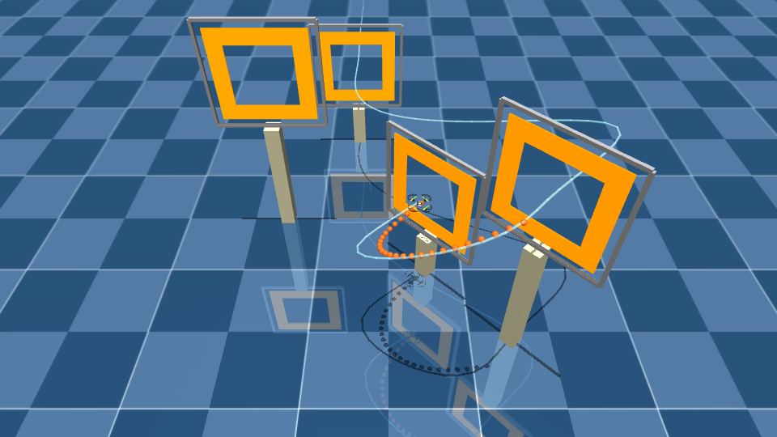
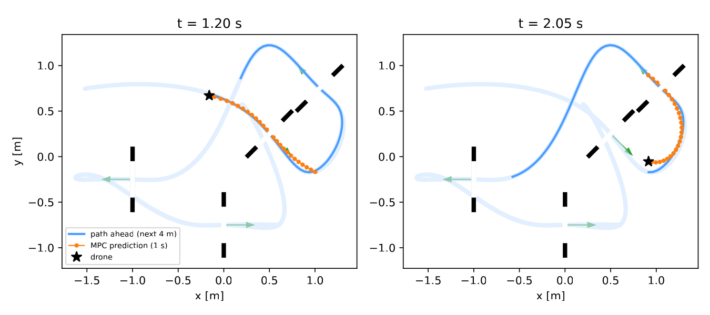
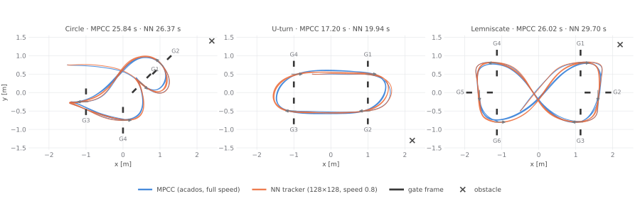

::: {.hero-section}

# Crazy Drone: Attitude and State-Based Control for Crazyflie Racing, from Simulation to Hardware {.title}

::: {.subtitle}
ECE 484 Principles of Safe Autonomy, UIUC, Fall 2026 · Team ZJUI Meta
:::

::: {.author-list}

[**Hanbin Zheng**](https://hanbinzheng.github.io/)^1,2^,
[**Shengrui Wang**](https://github.com/LunateELf)^1,2^,
[**Siyuan Wang**](https://github.com/mikkke117)^1,2^,
[**Xiang Li**](https://github.com/lx2005Jim)^1,2^

:::

::: {.affiliation-list}

^1^University of Illinois Urbana-Champaign,  ^2^Zhejiang University

:::

::: {.button-row}

[[ Code]{.btn-text}](https://github.com/safeautonomy-illinois-students/fa26_ece484_final_project_code_team_ZJUI_Meta){.btn .btn-primary}
[[ Videos]{.btn-text}](#video){.btn .btn-primary}
[[ MPCC Report]{.btn-text}](static/pdfs/mpcc_report.pdf){.btn .btn-primary}
[[ Solver Tutorial]{.btn-text}](static/pdfs/mpcc_solver_tutorial.pdf){.btn .btn-primary}
[[ Distillation Report]{.btn-text}](static/pdfs/distill_report.pdf){.btn .btn-primary}
[[ Course Project]{.btn-text}](https://safeautonomy-illinois.github.io/ece484-site/fall-2026/projects/quadrotor/){.btn .btn-primary}

:::

:::


<!-- ============================================================ -->
<!-- TEASER IMAGE / VIDEO -->
<!-- ============================================================ -->

::: {.section-container}

::: {.hero-teaser}

```{=html}
<video src="static/videos/teaser.mp4" poster="static/images/poster_mpcc.jpg" autoplay loop muted playsinline preload="auto" aria-label="Simulated Crazyflie flying through orange gates while the MPC prediction is drawn ahead of it"></video>
```

::: {.teaser-caption}
**Crazy Drone** flies a 43 g Crazyflie through gate courses at up to 2.8 m/s. The light-blue curve is the reference path; the orange dots are the 1 s trajectory the contouring MPC plans and re-solves every 10 ms.
:::

:::

:::


<!-- ============================================================ -->
<!-- ABSTRACT -->
<!-- ============================================================ -->

::: {.section-container}

## Abstract {.section-title}

::: {.abstract-text}
We fly a **Crazyflie 2.1** quadrotor through gate courses in the *crazyflow* MuJoCo simulator and on real hardware. The environment accepts two command interfaces at 100 Hz: **attitude** commands (collective thrust and roll, pitch, yaw), and **state** setpoints (position, velocity, acceleration and yaw) that the drone's onboard controller tracks. The drone sees the true pose of a gate only when it is within 0.7 m of it, and it has to finish five laps without touching anything. We turned **every challenge listed in the course README** into a reproducible stress test: a randomized start pose, shifted gates, obstacles on the racing line, wind and gusts, collision impulses, battery sag, a weak motor, a shorter sensor range, all of them at once, and the environment's own random layouts.

For the attitude interface, we adapt **Model Predictive Contouring Control** (MPCC) [1]. Instead of tracking a timed reference, the optimizer chooses its own progress along an arc-length path and trades speed against a gate-aware contouring error. It uses the system-identified closed-loop attitude model of the drone, a soft safe corridor around gate frames and obstacles, two disturbance observers, and replanning in about 1 ms whenever a gate is revealed. Solved with acados [2] in 0.95 ms per control step (median), it finishes **324 of 330** stress-test races on the three provided tracks and 171 of 176 on held-out random tracks.

We then **distill the MPCC optimizer into a small neural network**. The planner is kept unchanged; only the solver is replaced. The network (144-128-128-3, 35k parameters) is trained only on randomly generated tracks with randomly combined stress tests, first with behaviour cloning and then with seven DAgger iterations, with the MPCC as expert and safety pilot. With speed command 0.8 it finishes **312 of 330** races on the provided tracks, which it never saw in training, and 156 of 176 on random tracks, at 0.36 ms per control step with numpy only.

For the state interface, we use a **position-setpoint controller** that takes off, holds its position and moves in small steps on key presses. In simulation it survives **40 of 40** stress-test runs under wind with battery sag, repeated collision impulses and a weak motor, with at most 0.025 m mean horizontal drift. On a **real Crazyflie** with motion capture, the same controller takes off, holds a stable hover, moves in position steps and lands, which is our first step from simulation to hardware.
:::

:::

::: {.section-container}

::: {.stats-row}

::: {.stat}
[324/330]{.num}
[MPCC races finished on the 3 provided tracks × 11 stress conditions × 10 seeds]{.label}
:::

::: {.stat}
[312/330]{.num}
[Distilled network, same races, on tracks never seen in training]{.label}
:::

::: {.stat}
[0.36 ms]{.num}
[Network control step, vs. 0.95 ms for MPCC (median, whole step, one core)]{.label}
:::

::: {.stat}
[40/40]{.num}
[State-based controller stress-test runs survived in simulation]{.label}
:::

:::

:::


<!-- ============================================================ -->
<!-- OVERVIEW / METHOD VIDEO -->
<!-- ============================================================ -->

::: {#video .section-container}

## Video {.section-title}

::: {.comparison-grid}

::: {.comparison-item .video-item}

### Model Predictive Contouring Control



[[ YouTube](https://youtu.be/E5Mg6_XzqIM) [ Bilibili](https://b23.tv/2BIfKiX)]{.video-links}

acados SQP-RTI at 100 Hz; the orange dots are the 25-stage, 1 s prediction.

:::

::: {.comparison-item .video-item}

### Learning-Based Tracker (Distilled MPCC)



[[ YouTube](https://youtu.be/CASnObq0pI8) [ Bilibili](https://b23.tv/INTonYQ)]{.video-links}

Recorded with the earlier version (an ensemble of five 64×64 networks); the green curve is the 2.8 m of path the network sees.

:::

:::

::: {.content-text}

More recordings: [state-based controller stress tests in simulation](#state-based-controller) and [hardware flight on a real Crazyflie](#hardware).

:::

:::


<!-- ============================================================ -->
<!-- THE TASK -->
<!-- ============================================================ -->

::: {.section-container}

## The Task {.section-title}

::: {.content-text}

Each track is a sequence of square gates (0.72 m frame, 0.40 m opening, at 0.7 m or 1.2 m height) plus thin vertical obstacle poles. Gates must be crossed in order and along their local $+x$ axis, five laps in a row. Touching a gate, a pole or the floor, or leaving the flight volume, ends the race. The provided tracks are a **circle** (4 gates), a **U-turn** with 180° hairpins (4 gates) and a figure-eight **lemniscate** (6 gates).

- **Interface.** At 100 Hz the controller receives position, attitude, velocity and body rates, and returns $[\phi_c, \vartheta_c, \psi_c, f_c]$: roll, pitch and yaw angles in radians, then the collective thrust in newtons. Thrust comes *last*, as in the environment's action space and the hardware driver (the course README listed it first). The Crazyflie's onboard attitude loop does the rest. Physics runs at 500 Hz.
- **Partial observability.** Gate and obstacle poses are reported at their *nominal* values until the drone comes within the sensor range (0.7 m). The hardware environment masks motion-capture poses in exactly the same way.
- **Default disturbances.** Every run has action noise, random force noise of ±0.1 N, ±5 g mass and inertia randomization and a random start pose.

### The README stress tests

The course README lists the challenges the hidden evaluation tracks may contain. We turned each of them into a test condition, added on top of the default disturbances (`scripts/stress_test.py`; magnitudes are the README / `stress.py` example values):

:::

::: {.table-wrap}

| Condition | Setting |
|:--|:--|
| base | only the configs' default disturbances |
| start | start pose ±0.4 m in $x/y$, any yaw |
| shift | gates ±0.15 m / ±0.15 rad, obstacles ±0.15 m, true pose revealed within 0.7 m |
| obstacle | two extra poles on the nominal racing line |
| wind | 1.5 m/s steady wind (random direction) and 1.0 m/s gusts |
| impulse | 0.4 N pushes of 50 ms every 3 s, pseudo-random directions |
| battery | thrust loss growing linearly to 15 % at 30 s |
| motor | one (random) motor 10 % weaker |
| shift+sensor | shifted gates with the sensor range reduced to 0.4 m |
| all | all of the above at once |
| envrandom | the environment's own random layout (`[env.track] randomize = true`): a different track |

::: {.table-note}
Tight turns are covered by the U-turn track and the random tracks. Each condition is run with 10 seeds on each provided track (5 laps) and on 16 held-out random tracks (3 laps): 330 + 176 = 506 races per controller.
:::

:::

:::


<!-- ============================================================ -->
<!-- METHOD I: MPCC -->
<!-- ============================================================ -->

::: {.section-container}

## Method I: Model Predictive Contouring Control {.section-title}

::: {.pipeline}

::: {.step}
**Route** pre / center / post points per gate, detours
:::

::: {.step}
**Cubic spline** $C^2$ path through the route
:::

::: {.step}
**Arc-length path** $\mathbf{p}_d(\theta)$, weight $q_c(\theta)$, corridor $r(\theta)$
:::

::: {.step .is-solver}
**MPCC (acados)** SQP-RTI, $N=25$, 1 s horizon
:::

::: {.step}
**Command** $[\phi_c, \vartheta_c, \psi_c, f_c]$ at 100 Hz
:::

:::

::: {.pipeline-caption}
The path is replanned (in about 1 ms) whenever the true pose of a gate or obstacle is revealed.
:::

::: {.content-text}

### Contouring instead of tracking

A classical pipeline fixes a timed reference $\mathbf{p}_{\mathrm{ref}}(t)$ and tracks it. If the drone falls behind, it chases a reference point that may no longer be reachable. MPCC drops the time. The reference is a purely geometric path $\mathbf{p}_d(\theta)$, parameterized by arc length, and the progress $\theta$ becomes a state of the optimizer, with $\dot\theta = v_\theta$. The tracking error $\mathbf{e} = \mathbf{p} - \mathbf{p}_d(\theta)$ is split along the unit tangent $\mathbf{t}(\theta)$ into a *lag* part and a *contour* part:

$$
\mathbf{e}^l = (\mathbf{t}^\top \mathbf{e})\,\mathbf{t}, \qquad \mathbf{e}^c = \mathbf{e} - \mathbf{e}^l .
$$

Every 10 ms we solve, over a 1 s horizon of 25 stages,

$$
\begin{aligned}
\min_{\mathbf{u}_{0:N-1}} \; & \sum_{k=0}^{N} \Big( q_l \|\mathbf{e}^l_k\|^2 + q_c(\theta_k)\,\|\mathbf{e}^c_k\|^2 + \|\mathbf{u}_k\|^2_{R} - \mu\, v_{\theta,k} \Big) \\
\text{s.t.} \; & \text{dynamics, input and corridor constraints.}
\end{aligned}
$$

The progress reward $\mu v_\theta$ pushes the drone forward. The contour weight keeps it on the racing line. Because the speed profile is the result of the optimization, the drone slows down for tight turns and gates and speeds up on straights, and it may cut corners between gates.

### Adapting the paper to our Crazyflie drone

Romero et al. [1] control a 0.85 kg racing quadrotor through its four rotor thrusts. Our Crazyflie weighs 43 g and only accepts attitude and collective-thrust commands, so we use the model the simulator integrates, which is a **system-identified model of the closed loop** "Crazyflie + onboard attitude controller":

$$
\begin{aligned}
\dot{\mathbf{v}} &= \tfrac{1}{m} R(\boldsymbol\eta)\begin{bmatrix}0\\0\\c_f f\end{bmatrix} + \mathbf{g} + \tfrac{1}{m} R D R^\top \mathbf{v} + \hat{\mathbf{d}}, \\
\ddot{\boldsymbol\eta} &= \mathbf{a}_\eta \odot \boldsymbol\eta + \mathbf{b}_\eta \odot \dot{\boldsymbol\eta} + \mathbf{c}_\eta \odot \boldsymbol\eta_c + \hat{\mathbf{b}}, \\
\dot f &= \tfrac{1}{\tau_f}(f_c - f).
\end{aligned}
$$

Each Euler angle responds like a damped spring to its command (roll/pitch: 13.7 rad/s, damping 0.46, steady-state gain 0.73), and the thrust lags its command by 80 ms. As in the paper, the optimizer chooses the *rates* of the commands, which keeps them smooth and bounded. The state has 18 dimensions: position, angles, velocity, angle rates, thrust, the three commands, $\theta$ and $v_\theta$. The [solver tutorial](static/pdfs/mpcc_solver_tutorial.pdf) walks from a QP through SQP and RTI to how acados solves this problem.

### What we added for safety

- **Gate-aware contour weight.** A sum of Gaussians centred on the gates $\mathbf{g}_j$,
  $$
  q_c(\theta) = q_{\mathrm{nom}} + q_{\mathrm{gate}} \textstyle\sum_j \exp\!\big(-\|\mathbf{p}_d(\theta) - \mathbf{g}_j\|^2 / 2\sigma^2\big),
  $$
  is small between gates and large inside them. The drone may cut corners, but it threads the gates precisely.
- **Soft safe corridor.** At every stage the contour error must stay below the clearance to the nearest frame, pole or obstacle minus the drone's radius (0.13 m: the collision box's 0.099 m half-diagonal plus 3 cm), and poles get soft keep-out cylinders, larger while their pose is not revealed yet.
- **Disturbance observer.** A first-order observer estimates the unmodelled acceleration (wind, mass error, battery sag) from the difference between the measured and the predicted acceleration,
  $$
  \hat{\mathbf{d}} \leftarrow (1-\alpha)\,\hat{\mathbf{d}} + \alpha\Big(\tfrac{\mathbf{v}_t - \mathbf{v}_{t-1}}{\delta} - \mathbf{a}_{\mathrm{model}}\Big), \quad \alpha = 0.04 \;(\approx 0.25\ \mathrm{s}),
  $$
  and feeds it into the model (offset-free MPC). When it is large, the controller slows down.
- **Attitude bias observer.** A 10 % weak motor tilts the drone by about 0.08 rad at a level command. In the identified attitude model this is a constant angular-acceleration bias $\hat{\mathbf{b}}$, estimated from the one-step prediction error of the exactly discretized model, so MPCC simply commands the tilt that compensates it.
- **Caution near unrevealed objects.** Progress speed is capped at 1.5 m/s near gates and poles whose true pose is not known yet, scaled with the sensor range. When the pose is revealed, the path is replanned.
- **Yaw alignment and frame-aware crossings.** The square collision box needs 0.099 m of half-width through a gate rotated by 45°, so MPCC yaws with the next gate. Crossings are also checked against neighbouring frames, and the planner routes detours around poles on the racing line.
- **Hard layouts.** The environment's own random layouts often put gates face to face or next to a wall. Their reference is planned with curvature-bounded, clearance-aware Hybrid A\* routes and a curvature speed limit.

:::

::: {.comparison-grid}

::: {.comparison-item}
{fig-alt="3D view: the drone between two gates with a light-blue reference path and an orange dotted MPC prediction"}
:::

::: {.comparison-item}
{fig-alt="Two top-view snapshots of the path ahead and the MPC prediction, which leaves the path between gates and rejoins it inside the gates"}
:::

:::

:::


<!-- ============================================================ -->
<!-- METHOD II: DISTILLATION -->
<!-- ============================================================ -->

::: {.section-container}

## Method II: Distilling MPCC into a Neural Tracker {.section-title}

::: {.pipeline}

::: {.step}
**Same planner** route, spline, $q_c$, corridor, speed cap, replanning
:::

::: {.step}
**144 features** path ahead, weights, state, last command, $\hat{\mathbf{d}}$, $\hat{\mathbf{b}}$
:::

::: {.step .is-learned}
**MLP** 144-128-128-3, tanh, 35k parameters
:::

::: {.step}
**Integrate & clip** $\Delta[\phi_c, \vartheta_c, f_c]$ within MPCC's limits
:::

:::

::: {.pipeline-caption}
Only the outlined orange block is learned. Everything else is shared with the MPCC controller.
:::

::: {.content-text}

### Distill only the optimizer

We distill the MPCC solver into a network by imitation learning: behaviour cloning, followed by DAgger. The planning half of MPCC is cheap and has nothing to learn, so we keep it exactly and let the network replace only the nonlinear program. The network is a **path tracker**. It sees 20 samples of the path ahead, 0.14 m apart (2.8 m, as far as MPCC's horizon reaches at top speed), the contour weight, corridor radius and speed cap at those samples, the drone state, the previous command, both disturbance estimates and the two nearest obstacles (with a flag for whether each is still unrevealed). All of these are expressed in a heading frame centred on the drone, so the network cannot memorize where on the map it is. It outputs the *change* of the roll, pitch and thrust commands, which is MPCC's first optimal input. That makes its commands as smooth and bounded as MPCC's by construction; yaw is commanded 0.

**Speed command.** The speed enters only through the speed-cap features: the teacher flies with a random `speed_scale` $\in\{0.6, \dots, 1.0\}$ per training episode, its caps shrink accordingly, and the network sees the same caps. At deployment the same knob trades lap time for safety margin without retraining.

### Random tracks, random stress, DAgger, and an expert-in-the-loop safety pilot

To show that the tracker works for *any* path, we train only on **procedurally generated tracks** (3–6 gates, random headings and heights, 0–3 obstacles placed near the path). Every training episode switches each README stress test on at random (shift 60 %, start, obstacle, wind, impulse and battery 30 % each, motor 25 %, short sensor range 20 %) at 0.6, 1.0 or 1.25 times the README magnitude. The three provided tracks are held out for testing.

Behaviour cloning alone suffers from distribution shift: small errors compound into states the expert never visited [6]. With **DAgger** [3], the student flies and MPCC labels every visited state in shadow mode. If the student leaves the corridor by more than 2 cm, MPCC takes over for 1 s, still labelling, which yields exactly the recovery data the student needs. A fifth of the episodes are MPCC flights with correlated command noise (DART [4]). Behaviour cloning on 600 episodes plus seven DAgger iterations of 400 episodes give 3.7 M samples in 78 minutes on one laptop CPU.

::: {.note}
**Fix the teacher first.** A student cannot beat its teacher, so before training we ran MPCC through every stress test and fixed what failed: the weak motor (attitude bias observer), late reveals with a short sensor range (speed cap scaled with the range), poles on the racing line (detour waypoints), impulses at gates (the speed command), and later the remaining gate-frame contacts (yaw alignment, frame-aware crossings). An earlier fix of the same kind: the corridor used to reserve only $r_{\mathrm{drone}} = 0.10$ m for a 0.099 m half-diagonal, 1 mm of margin inside a gate.
:::

### What did not pay off

PPO fine-tuning [5] of an earlier version did not improve it (two runs of about 1M steps): rare near-misses at gate frames are too noisy a signal at that budget. An ensemble of five 128×128 networks was better on validation tracks at full speed but not on the test at speed 0.8, so the single network is the default. In the earlier version, an ensemble of five 64×64 networks (67k parameters) had finished 88 of 90 races with shifted gates and wind only.

:::

:::


<!-- ============================================================ -->
<!-- RESULTS -->
<!-- ============================================================ -->

::: {.section-container}

## Results {.section-title}

::: {.content-text}

### README stress tests

:::

::: {.table-wrap}

| Condition | []{.swatch .mpcc}MPCC, provided (of 30) | []{.swatch .nn}Network, provided (of 30) | []{.swatch .mpcc}MPCC, random (of 16) | []{.swatch .nn}Network, random (of 16) |
|:--|--:|--:|--:|--:|
| base | 30 | 30 | 16 | 16 |
| start | 30 | 30 | 16 | 16 |
| shift | 30 | **29** | **15** | **12** |
| obstacle | 30 | 30 | 16 | 16 |
| wind | 30 | 30 | 16 | **15** |
| impulse | **28** | **29** | **15** | **15** |
| battery | 30 | 30 | 16 | **15** |
| motor | 30 | 30 | 16 | 16 |
| shift+sensor | 30 | **29** | **15** | **12** |
| all | **26** | **24** | **14** | **9** |
| envrandom | 30 | **21** | 16 | **14** |
| **total** | **324/330** | **312/330** | **171/176** | **156/176** |

::: {.table-note}
Run on 2026-11-19 with the current code. Provided tracks: 3 tracks × 10 seeds per condition, 5 laps. Random tracks: 16 held-out tracks per condition, 3 laps, seeds never used for training or model selection. MPCC at full speed, the network at its default speed command 0.8. A race counts only if all laps are finished without any contact. Bold: fewer than all races finished.
:::

:::

::: {.content-text}

### Lap times and computation

:::

::: {.table-wrap}

| Controller | Params | Circle [s] | U-turn [s] | Lemniscate [s] | Step [ms], median / p99 / max | Gate offset [m] |
|:--|--:|--:|--:|--:|--:|--:|
| []{.swatch .mpcc}MPCC | — | 25.60 ± 0.40 | 17.10 ± 0.18 | 25.87 ± 0.45 | 0.95 / 1.85 / 2.31 | 0.129 |
| []{.swatch .nn}**Network (ours)** | **35k** | **26.56 ± 0.39** | **19.94 ± 0.13** | **29.59 ± 0.28** | **0.36 / 0.62 / 0.84** | **0.136** |

::: {.table-note}
Lap times: mean ± std of the 5-lap time over the 10 *base* runs. Step: the whole `compute_control` call (state estimation, observers, replanning, features and solver or network) on one core, one 5-lap flight per track, about 7,000 steps per controller; the network's forward pass alone takes about 10 μs. Gate offset: 3D distance from the drone to the gate centre at the first control step after a gate is passed (the drone is then up to about 3 cm behind the gate plane), maximum over all gates of all finished stress-test races on the provided tracks; the opening's half-width is 0.2 m. MPCC at full speed, the network at speed 0.8.
:::

:::

::: {.content-text}

- **Every MPCC failure on the provided tracks followed a collision impulse.** All six crashes (two *impulse* races on the circle, four *all* races on the lemniscate) happen 0.13–0.48 s after a 0.4 N push that arrives just before a gate at 1.8–2.7 m/s; the push changes the velocity by about 0.47 m/s and the drone grazes an inner plate of the opening (1.5–7.5 mm penetration). With 13 cm of margin and a few tenths of a second left, a nominal MPC cannot recover; every other single README condition is 30/30.
- **The network is almost as safe on unseen tracks.** On the provided tracks it passes every single README condition at least 29 of 30 times; it loses ground with all stresses at once (24/30) and on the environment's random layouts (21/30), a kind of reference it was never trained on. On random tracks its failures concentrate on a few tight layouts with shifted gates revealed late.
- **Cost and speed.** The network needs 2.6× less time per step than MPCC and no solver; no step of either controller came close to the 3 ms budget we set ourselves (worst: 2.3 ms for MPCC, 0.8 ms for the network). At its default speed command 0.8 its laps are 4–17 % slower; at full speed it is clearly less safe than MPCC, so we trade lap time for margin.

:::

:::


<!-- ============================================================ -->
<!-- QUALITATIVE COMPARISONS -->
<!-- ============================================================ -->

::: {.section-container}

## Qualitative Comparisons {.section-title}

::: {.content-text}

### MPCC vs. the distilled network

:::

::: {.wide-figure}
{fig-alt="Top views of five-lap flights on the circle, U-turn and lemniscate tracks; the MPCC and network trajectories nearly coincide"}
:::

::: {.figure-note}
Five laps on each provided track (top view, same seed, default disturbances). [**Blue**]{style="color:#2a78d6"}: MPCC at full speed. [**Orange**]{style="color:#eb6834"}: the distilled network at speed 0.8, which has never seen these tracks. Gate frames are drawn with the crossing direction as an arrow; × marks an obstacle.
:::

::: {.content-text}

### Baseline: spline + cascaded PID

Our first controller, presented at the midterm, separates **planning** from **control**. Before takeoff, a geometric planner turns the gate layout into a time-parameterized **cubic-spline trajectory**. It places waypoints before, at and after each gate so the drone crosses every gate head-on, and it adds detour waypoints whenever the next gate lies behind the drone. Segments that exceed an acceleration budget are retimed, so the drone slows down only in tight turns. An iterative repair step then pushes the path clear of any gate frame or stand it still touches. A **cascaded attitude controller** tracks this reference: a PID position loop with acceleration feedforward computes a desired thrust vector, which is mapped through the drone's identified thrust and attitude model into collective-thrust and roll/pitch commands, with limits on tilt and thrust.

In the *crazyflow* simulator the drone finished all five laps on every track and passed every gate (20, 20 and 30 gates), reaching speeds close to 2 m/s. Mean tracking error stayed between 0.052 m and 0.058 m, and the maximum error was 0.133 m. These numbers come from one run per track with seed 0. In each plot, the dashed gray line is the planned reference, the colored line is the flown trajectory shaded by speed, orange bars are gates with red arrows showing the crossing direction, and × marks an obstacle.

:::

::: {.results-grid}

::: {.result-card}

:::

::: {.result-card}

:::

::: {.result-card}

:::

:::

:::


<!-- ============================================================ -->
<!-- STATE-BASED CONTROLLER -->
<!-- ============================================================ -->

::: {.section-container}

## State-Based Controller {.section-title}

::: {.content-text}

The racing controllers above use the attitude interface. The environment also offers a state interface, in which the controller sends a 13-value full-state setpoint (position, velocity, acceleration, yaw and body rates) and the Crazyflie's onboard controller tracks it.

Our state-based controller is a position-setpoint controller. After start it takes off to 0.5 m and holds that position on its own. Each key press moves the setpoint by 0.1 m; the commanded position follows the setpoint at no more than 0.3 m/s and always stays 0.3 m inside the track's safety limits. Pressing `l` ends the flight; on hardware the drone then hovers until the operator confirms landing. We use the same controller in simulation and on the real Crazyflie, where it flew our first stable hover (see [Hardware](#hardware)).

### Stress tests in simulation

The drone takes off to 0.5 m and holds its start position for 30 s with no key presses, at a 25 Hz control rate. Each condition adds one disturbance on top of the small random force and start randomization that all four tests share. The impulse and weak-motor tests use the same magnitudes as the [README stress tests](#the-readme-stress-tests) of the racing controllers. Wind and battery sag use the values of our earlier MPCC stress test (about 1.1 m/s wind, 10 % thrust loss), milder than the README's 1.5 m/s and 15 %.

:::

::: {.table-wrap}

| Condition | Disturbance | Survived | Deviation, mean / max [m] | Horizontal deviation, mean [m] |
|:--|:--|--:|--:|--:|
| Baseline | none | 10/10 | 0.076 / 0.112 | 0.008 |
| Wind + battery sag | wind [0.91, 0.62, 0] m/s with 0.8 m/s gusts; thrust loss ramps to 10% at 25 s | 10/10 | 0.065 / 0.116 | 0.019 |
| Collision impulses | 0.4 N push for 50 ms in a pseudo-random direction every 3 s, first at 2 s | 10/10 | 0.080 / **0.149** | 0.020 |
| Weak motor | motor 0 missing 10% of its hover thrust | 10/10 | 0.077 / 0.127 | **0.025** |

::: {.table-note}
10 seeds per condition. Survived: no crash and never outside the safety limits. Deviation is the 3D distance to the hold point. Most of it is a steady height offset of about 0.08 m from the simulated onboard position controller, which is present even without disturbances, so the horizontal deviation shows the effect of each disturbance more clearly.
:::

:::

::: {.content-text}

- **Every run survived.** In all 40 runs the drone held its position and stayed inside the safety limits.
- **Horizontal drift stays small.** It rises from 0.008 m without disturbances to at most 0.025 m with the weak motor, whose constant extra torque the onboard controller has to fight all the time.
- **Impulses cause the largest peaks.** Each push briefly moves the drone up to 0.149 m from the hold point before the onboard controller brings it back.
- **Battery sag partly hides the height offset.** The thrust loss pulls the drone down a little, against the 0.08 m offset, which is why the mean deviation with wind and battery sag is lower than the baseline.

:::

::: {.comparison-grid}

::: {.comparison-item .video-item}

### 1 · Baseline Hover



[[ YouTube](https://youtu.be/tTPvJ5Kj_yI)]{.video-links}

No stress disturbance; the reference for the other three tests.

:::

::: {.comparison-item .video-item}

### 2 · Wind Gusts + Battery Sag



[[ YouTube](https://youtu.be/w5vlEU6zzls)]{.video-links}

Same wind and battery values as our earlier MPCC stress test.

:::

::: {.comparison-item .video-item}

### 3 · Repeated Collision Impulses



[[ YouTube](https://youtu.be/qNZ3STJscx0)]{.video-links}

A 0.4 N push every 3 s; the largest peak deviation of the four tests.

:::

::: {.comparison-item .video-item}

### 4 · Weak Motor (−10% Thrust)



[[ YouTube](https://youtu.be/84grXt0WM2M)]{.video-links}

A constant roll/pitch/yaw torque; the largest horizontal drift of the four tests.

:::

:::

::: {.content-text}

All four videos are rendered at real-time speed. Full playlist: [YouTube](https://www.youtube.com/playlist?list=PLZ_75Cro2Un4).

:::

:::


<!-- ============================================================ -->
<!-- HARDWARE -->
<!-- ============================================================ -->

::: {.section-container}

## Hardware {.section-title #hardware}

::: {.content-text}

We flew our state-based controller (see [State-Based Controller](#state-based-controller)) on a real Crazyflie 2.1, with the pose from the motion capture system. The drone takes off, holds a stable hover, moves sideways in position steps from key presses at a constant height, and lands.



[[ YouTube](https://youtu.be/vrF_shNfDUU)]{.video-links}

### Flight software

The software we fly the real Crazyflie with:

- **Kill switch.** Pressing SPACE cuts the motors at any time.
- **Stale-pose watchdog.** Cuts the motors if no motion-capture pose of the drone arrives for more than 100 ms. It watches the raw motion-capture messages, because the estimator keeps predicting poses after the drone is lost.
- **Low-height test flights.** The state-based controller lets us test the radio, motion capture, estimator and safety features at low height before flying a racing controller.
- **Radio link check.** Counts acknowledged packets and reads battery voltage and supervisor state, without ever arming the drone.
- **Startup procedure.** Written instructions for motion capture, estimator and deployment in our lab setup.

:::

:::


<!-- ============================================================ -->
<!-- LIMITATIONS -->
<!-- ============================================================ -->

::: {.section-container}

## Limitations & Next Steps {.section-title}

::: {.content-text}

- **Hardware racing.** So far only the state-based controller has flown on hardware, and only a hover with manual position steps. Next we fly a simple track on the real drone, first by sending a planned path through the gates as state setpoints, then with MPCC in attitude mode.
- **Sim-to-real.** Radio and estimator delay are not modelled. Forward-predicting the initial state over the known delay before solving (or before querying the network) is the standard remedy, and delay and estimator noise should be added as randomizations before training. The gate geometry is a second gap: the gate centres reported by motion capture are not exact, and the real gates (frame and stand) do not have the same shape as the simulated ones, so the corridor and clearances computed from the model are biased, while the corridor leaves only 7 cm inside an opening. The gate model and the margin have to be calibrated on the real gates.
- **Impulses right before a gate.** A 0.4 N push 0.1 s before a 0.13 m-margin opening at full speed cannot be absorbed by a nominal MPC; a lower speed command removes most of these failures.
- **Hard layouts.** The network was trained only on tracks whose ordinary spline reference is valid, so it never saw the slow, curvature-limited Hybrid A\* references of the environment's random layouts; adding them to the DAgger distribution is the next step. On ordinary tracks planning takes about 1 ms, but the Hybrid A\* search runs in Python and takes 1–35 s on a hard layout. It runs once, before take-off, so it is not part of the step times above; hard layouts combined with in-flight replanning (shifted gates) have not been tested yet.
- **Supervision.** A supervisor that hands control back to MPCC when the drone leaves the corridor, the same rule we used to collect data, would combine the network's low cost with MPCC's recovery.

:::

:::


<!-- ============================================================ -->
<!-- TEAM ROLES -->
<!-- ============================================================ -->

::: {.section-container}

## Team Roles {.section-title}

::: {.content-text}

- **Hanbin:** classical control / planning; hardware debugging and flight recording
- **Xiang:** learning / training; hardware setup
- **Shengrui:** evaluation; state-based controller stress tests; hardware flight operation and safety tooling
- **Siyuan:** simulation integration / presentation / project website; hardware setup

:::

:::


<!-- ============================================================ -->
<!-- RELATED WORK / REFERENCES -->
<!-- ============================================================ -->

::: {.section-container}

## References {.section-title}

::: {.content-text}

1. A. Romero, S. Sun, P. Foehn, D. Scaramuzza. [Model Predictive Contouring Control for Time-Optimal Quadrotor Flight](https://arxiv.org/abs/2108.13205). *IEEE Transactions on Robotics*, 2022.
2. R. Verschueren et al. [acados: a modular open-source framework for fast embedded optimal control](https://docs.acados.org/). *Mathematical Programming Computation*, 2022.
3. S. Ross, G. Gordon, D. Bagnell. [A Reduction of Imitation Learning and Structured Prediction to No-Regret Online Learning](https://arxiv.org/abs/1011.0686). *AISTATS*, 2011.
4. M. Laskey, J. Lee, R. Fox, A. Dragan, K. Goldberg. [DART: Noise Injection for Robust Imitation Learning](https://arxiv.org/abs/1703.09327). *CoRL*, 2017.
5. J. Schulman, F. Wolski, P. Dhariwal, A. Radford, O. Klimov. [Proximal Policy Optimization Algorithms](https://arxiv.org/abs/1707.06347). arXiv:1707.06347, 2017.
6. S. Levine. [CS 285: Deep Reinforcement Learning](https://rail.eecs.berkeley.edu/deeprlcourse/). Lecture course, University of California, Berkeley. Lecture 2 (behaviour cloning, distribution shift, DAgger).
7. [ECE 484 Fall 2026 Quadrotor Project](https://safeautonomy-illinois.github.io/ece484-site/fall-2026/projects/quadrotor/), University of Illinois Urbana-Champaign.

:::

:::


<!-- ============================================================ -->
<!-- BIBTEX -->
<!-- ============================================================ -->

::: {.section-container}

## BibTeX {.section-title}

```bibtex
@misc{zjuimeta2026crazydrone,
  title  = {Crazy Drone: Attitude and State-Based Control for Crazyflie Racing, from Simulation to Hardware},
  author = {Zheng, Hanbin and Wang, Shengrui and Wang, Siyuan and Li, Xiang},
  note   = {ECE 484 Final Project, University of Illinois Urbana-Champaign},
  year   = {2026},
  url    = {https://safeautonomy-illinois-students.github.io/fa26_ece484_final_project_site_team_ZJUI_Meta/}
}
```

:::


<!-- ============================================================ -->
<!-- FOOTER -->
<!-- ============================================================ -->

::: {.site-footer}

This website template is adapted from the
[Nerfies](https://nerfies.github.io) project page, which is licensed under a
[Creative Commons Attribution-ShareAlike 4.0 International License](http://creativecommons.org/licenses/by-sa/4.0/).

:::

```{=html}
<script>
  // Respect reduced motion: keep the teaser paused on its poster, with controls to play it.
  if (window.matchMedia("(prefers-reduced-motion: reduce)").matches) {
    document.querySelectorAll(".hero-teaser video").forEach(function (v) {
      v.removeAttribute("autoplay");
      v.pause();
      v.controls = true;
    });
  }
</script>
```
