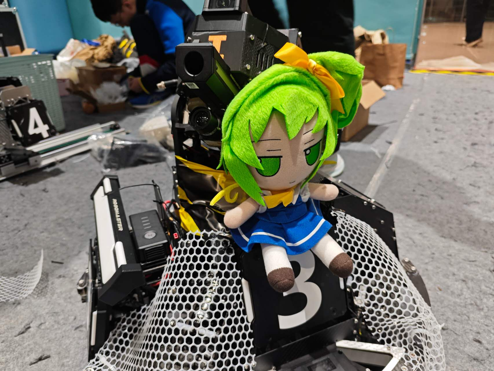
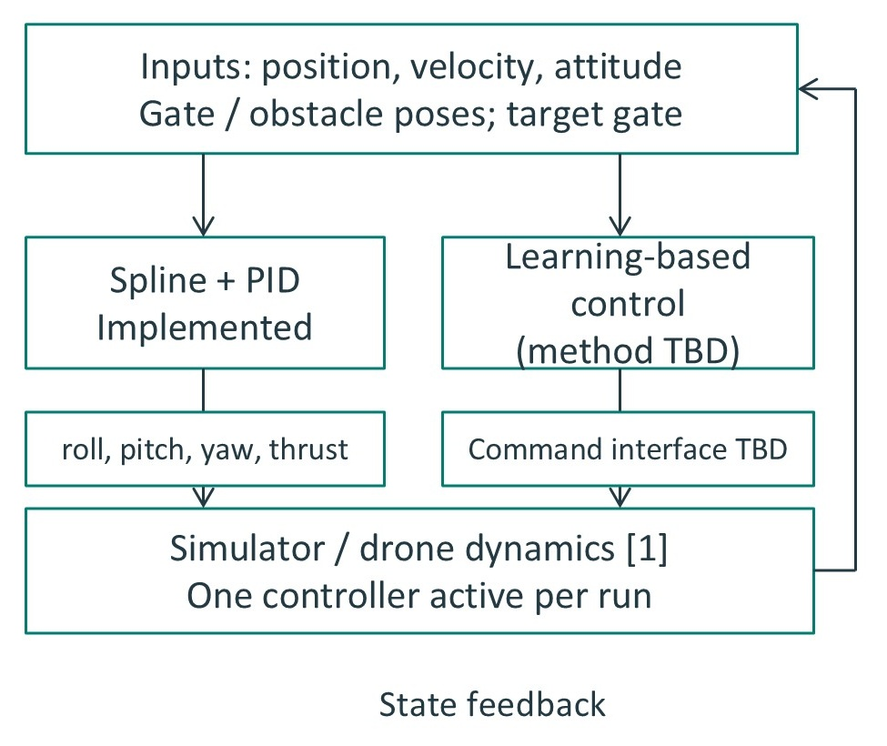
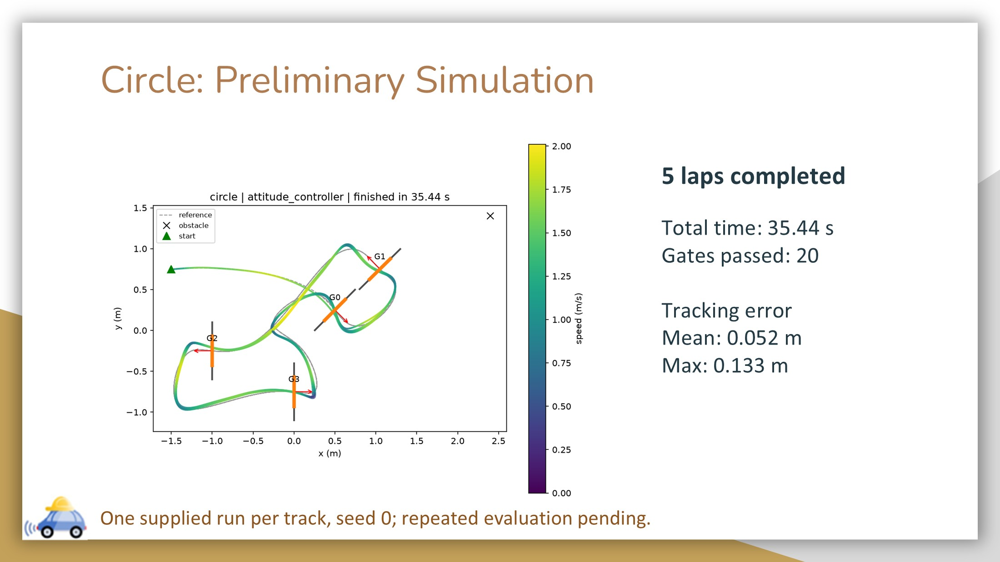
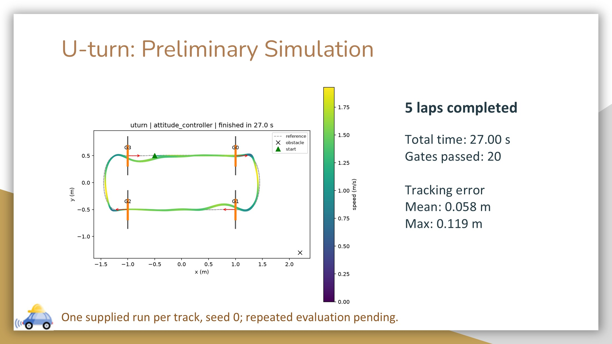
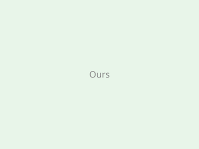
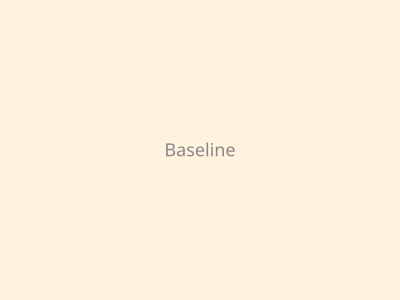

::: {.hero-section}

# ECE 484 Drone Race by team ZJUI Meta {.title}

::: {.subtitle}
Gate-crashers wanted: build controllers that thread a Crazyflie through wind, gusts and tight turns in sim, then race it for real.
:::

::: {.author-list}

[**Hanbin Zheng**](https://github.com/hanbinzheng)^1,2^,
[**Shengrui Wang**](https://github.com/LunateELf)^1,2^,
[**Siyuan Wang**](https://github.com/mikkke117)^1,2^
[**Xiang Li**](https://github.com/lx2005Jim)^1,2^

:::

::: {.affiliation-list}

^1^University of Illinois at Urbana-Champaign,  ^2^Zhejiang University

:::

::: {.button-row}

<!--
[[ Paper]{.btn-text}](https://arxiv.org/pdf/XXXX.XXXXX){.btn .btn-primary}
[[ arXiv]{.btn-text}](https://arxiv.org/abs/XXXX.XXXXX){.btn .btn-primary}
[[ Video]{.btn-text}](https://www.youtube.com/watch?v=cSQTZoZPJzs&list=PLN1LPImPw_PlDRy10sDskVGszKZcbXaDn&index=2){.btn .btn-primary}
-->
[[ Code]{.btn-text}](https://github.com/safeautonomy-illinois-students/fa26_ece484_final_project_code_team_ZJUI_Meta){.btn .btn-primary}
<!--
[[ Data]{.btn-text}](https://example.com){.btn .btn-primary}
-->

:::

:::


<!-- ============================================================ -->
<!-- TEASER IMAGE / VIDEO -->
<!-- ============================================================ -->

::: {.section-container}

::: {.hero-teaser}

<!-- Option A: Use a static image as the teaser -->
<!--
{.teaser-img}
-->
{.teaser-img}

<!-- Option B: Embed a video teaser (uncomment below, comment out image above)

-->

:::

:::


<!-- ============================================================ -->
<!-- ABSTRACT -->
<!-- ============================================================ -->

::: {.section-container}

## Abstract {.section-title}

::: {.abstract-text}
We develop controllers that fly a **Crazyflie 2.1** quadrotor through
gate-based race tracks autonomously, both in the *crazyflow* MuJoCo simulator
and on real hardware in a motion-capture arena. To score, the drone has to
finish five laps without a collision. Hidden evaluation tracks make this harder
with randomized start poses, tight 180° hairpins, stationary obstacles, steady
wind and gusts, collision impulses, battery sag and motor imbalance.

Our approach separates **planning** from **control**. Before takeoff, a
geometric planner turns the gate layout into a time-parameterized
**cubic-spline trajectory**. It places waypoints before, at and after each gate
so the drone crosses every gate head-on, and it adds detour waypoints whenever
the next gate lies behind the drone. Segments that exceed an acceleration
budget are retimed, so the drone slows down only in tight turns. An iterative
repair step then pushes the path clear of any gate frame or stand it still
touches. A **cascaded attitude controller** tracks this reference: a PID
position loop with acceleration feedforward computes a desired thrust vector,
which is mapped through the drone's identified thrust and attitude model into
collective-thrust and roll/pitch commands, with limits on tilt and thrust.

Next, we will add a learning-based controller, stress-test both controllers
against every disturbance in simulation, and transfer the better one to the
Crazyflie for the final race.
:::

:::


<!-- ============================================================ -->
<!-- OVERVIEW / METHOD VIDEO -->
<!-- ============================================================ -->

<!--
::: {.section-container}

## Video {.section-title}

::: {.video-container}
-->
<!-- Replace with your YouTube or local video embed -->
<!--

:::

:::
-->


::: {.section-container}

## Plan and Preliminary Work {.section-title}

::: {.columns}

::: {.column .content-text width="42%"}

- **Available:** simulator, observations and three tracks.
- **Implemented:** spline planning, position PID and feedforward.
- **Planned:** learning-based control (method TBD).
- **Initial simulations:** five laps on all three tracks, one run each.

:::

::: {.column width="58%"}



:::

:::

:::


<!-- ============================================================ -->
<!-- RESULTS GALLERY -->
<!-- ============================================================ -->

<!--
::: {.section-container}

## Results {.section-title}

::: {.content-text}
Provide a brief description of the results shown below. Explain what the
reader should observe and why it matters.
:::

::: {.results-grid}

::: {.result-card}

:::

::: {.result-card}

:::

::: {.result-card}

:::

:::

:::
-->


::: {.section-container}

## Preliminary Results {.section-title}

::: {.content-text}
We evaluated the spline planner and the cascaded attitude controller in the
*crazyflow* simulator on three tracks: **circle**, **U-turn** and
**figure-eight**. In each plot, the dashed gray line is the planned reference,
the colored line is the flown trajectory shaded by speed, orange bars are
gates with red arrows showing the crossing direction, and × marks an obstacle.

The drone finished all five laps on every track and passed every gate
(20, 20 and 30 gates), reaching speeds close to 2 m/s. Mean tracking error
stayed between 0.052 m and 0.058 m, and the maximum error was 0.133 m.

These numbers come from one run per track with seed 0. Repeated evaluation
under randomized disturbances is still pending.
:::

::: {.results-grid}

::: {.result-card}

:::

::: {.result-card}

:::

::: {.result-card}

:::

:::

:::


<!-- ============================================================ -->
<!-- QUALITATIVE COMPARISONS -->
<!-- ============================================================ -->

<!--
::: {.section-container}

## Qualitative Comparisons {.section-title}

::: {.content-text}
Describe the comparison setup — which baselines are you comparing against, and
what should the reader look for in the side-by-side results.
:::

::: {.comparison-grid}

::: {.comparison-item}


**Ours**
:::

::: {.comparison-item}


**Baseline A**
:::

:::

:::
-->


<!-- ============================================================ -->
<!-- INTERACTIVE SLIDER (Optional) -->
<!-- ============================================================ -->

<!--
::: {.section-container}

## Interpolation Demo {.section-title}

::: {.content-text}
If your method supports interpolation or continuous control, you can add an
interactive slider here. The example below shows how to set one up.
:::

::: {.interpolation-panel}

::: {.interpolation-endpoints}
{.endpoint-img}

{.endpoint-img}
:::

<input type="range" min="0" max="100" value="50" class="interpolation-slider" id="interpolation-slider">
<div id="interpolation-value" class="interpolation-value">50%</div>

<script>
  const slider = document.getElementById('interpolation-slider');
  const display = document.getElementById('interpolation-value');
  slider.addEventListener('input', function() {
    display.textContent = this.value + '%';
  });
</script>

:::

:::
-->


<!-- ============================================================ -->
<!-- RELATED WORK -->
<!-- ============================================================ -->

<!--
::: {.section-container}

## Related Work {.section-title}

::: {.content-text}

Here are some related works in this area:

- [Related Paper 1](https://example.com) introduces an idea similar to ours for [topic].
- [Related Paper 2](https://example.com) also addresses [problem] using [approach].
- [Related Paper 3](https://example.com) proposes [technique] which is complementary to our method.

Check out [this survey](https://example.com) for a comprehensive overview of the field.
:::

:::
-->


<!-- ============================================================ -->
<!-- BIBTEX -->
<!-- ============================================================ -->

<!--
::: {.section-container}

## BibTeX {.section-title}

```bibtex
@article{yourname2026project,
  author    = {Author One and Author Two and Author Three},
  title     = {Your Project Title Here},
  journal   = {Conference or Journal Name},
  year      = {2026},
}
```

:::
-->


<!-- ============================================================ -->
<!-- FOOTER -->
<!-- ============================================================ -->

::: {.site-footer}

This website template is adapted from the
[Nerfies](https://nerfies.github.io) project page, which is licensed under a
[Creative Commons Attribution-ShareAlike 4.0 International License](http://creativecommons.org/licenses/by-sa/4.0/).

:::
