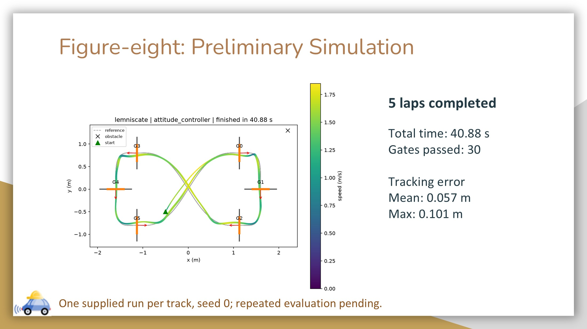

::: {.hero-section}

# Crazy Drone: Contouring MPC and a Distilled Neural Tracker for Crazyflie Racing {.title}

::: {.subtitle}
ECE 484 Principles of Safe Autonomy, UIUC, Fall 2026 · Team ZJUI Meta
:::

::: {.author-list}

[**Hanbin Zheng**](https://hanbinzheng.github.io/)^1,2^,
[**Shengrui Wang**](https://github.com/LunateELf)^1,2^,
[**Siyuan Wang**](https://github.com/mikkke117)^1,2^,
[**Xiang Li**](https://github.com/lx2005Jim)^1,2^

:::

::: {.affiliation-list}

^1^University of Illinois Urbana-Champaign,  ^2^Zhejiang University

:::

::: {.button-row}

[[ Code]{.btn-text}](https://github.com/safeautonomy-illinois-students/fa26_ece484_final_project_code_team_ZJUI_Meta){.btn .btn-primary}
[[ Videos]{.btn-text}](#video){.btn .btn-primary}
[[ MPCC Report]{.btn-text}](static/pdfs/mpcc_report.pdf){.btn .btn-primary}
[[ Distillation Report]{.btn-text}](static/pdfs/distill_report.pdf){.btn .btn-primary}
[[ Course Project]{.btn-text}](https://safeautonomy-illinois.github.io/ece484-site/fall-2026/projects/quadrotor/){.btn .btn-primary}

:::

:::


<!-- ============================================================ -->
<!-- TEASER IMAGE / VIDEO -->
<!-- ============================================================ -->

::: {.section-container}

::: {.hero-teaser}

```{=html}
<video src="static/videos/teaser.mp4" poster="static/images/poster_mpcc.jpg" autoplay loop muted playsinline preload="auto" aria-label="Simulated Crazyflie flying through orange gates while the MPC prediction is drawn ahead of it"></video>
```

::: {.teaser-caption}
**Crazy Drone** flies a 43 g Crazyflie through gate courses at up to 2.8 m/s. The light-blue curve is the reference path; the orange dots are the 1 s trajectory the contouring MPC plans and re-solves every 10 ms.
:::

:::

:::


<!-- ============================================================ -->
<!-- ABSTRACT -->
<!-- ============================================================ -->

::: {.section-container}

## Abstract {.section-title}

::: {.abstract-text}
We race a **Crazyflie 2.1** quadrotor through gate courses in the *crazyflow* MuJoCo simulator. The drone may only send collective-thrust and attitude commands at 100 Hz. It sees the true pose of a gate only when it is within 0.7 m of it, and it has to finish five laps without touching anything, under action noise, mass randomization, shifted gates, wind, gusts and battery sag.

Our first controller adapts **Model Predictive Contouring Control** (MPCC) [1] to this interface. Instead of tracking a timed reference, the optimizer chooses its own progress along an arc-length path and trades speed against a gate-aware contouring error. It uses the system-identified closed-loop attitude model of the drone, a soft safe corridor around gate frames and obstacles, a disturbance observer, and replanning whenever a gate is revealed. Solved with acados [2] in about 1.3 ms per step, it finishes **90 of 90** simulated races on the three provided tracks.

Our second controller **distills the MPCC optimizer into small neural networks**. The planner is kept unchanged; only the solver is replaced. The networks are trained only on randomly generated tracks, first with behaviour cloning and then with DAgger, with the MPCC as expert and safety pilot. Along the way we found and fixed a margin bug in the expert itself. An ensemble of five 64×64 networks (67k parameters) finishes **88 of 90** races on the provided tracks, which it never saw in training, within 0.3 s of MPCC's lap times, at 0.7 ms per control step and with no optimizer on board.
:::

:::

::: {.section-container}

::: {.stats-row}

::: {.stat}
[90/90]{.num}
[MPCC races finished on the 3 tracks × 3 conditions]{.label}
:::

::: {.stat}
[88/90]{.num}
[Distilled network ensemble, on tracks never seen in training]{.label}
:::

::: {.stat}
[17.0 s]{.num}
[Mean time for 5 laps of the U-turn track (MPCC, nominal)]{.label}
:::

::: {.stat}
[0.7 ms]{.num}
[Network control step, vs. 3.5 ms for MPCC (median, incl. features)]{.label}
:::

:::

:::


<!-- ============================================================ -->
<!-- OVERVIEW / METHOD VIDEO -->
<!-- ============================================================ -->

::: {#video .section-container}

## Video {.section-title}

::: {.comparison-grid}

::: {.comparison-item .video-item}

### Model Predictive Contouring Control



[[ YouTube](https://youtu.be/E5Mg6_XzqIM) [ Bilibili](https://b23.tv/2BIfKiX)]{.video-links}

acados SQP-RTI at 100 Hz; the orange dots are the 25-stage, 1 s prediction.

:::

::: {.comparison-item .video-item}

### Learning-Based Tracker (Distilled MPCC)



[[ YouTube](https://youtu.be/CASnObq0pI8) [ Bilibili](https://b23.tv/INTonYQ)]{.video-links}

Five 64×64 MLPs, averaged; the green curve is the 2.8 m of path the networks see.

:::

:::

:::


<!-- ============================================================ -->
<!-- THE TASK -->
<!-- ============================================================ -->

::: {.section-container}

## The Task {.section-title}

::: {.content-text}

Each track is a sequence of square gates (0.72 m frame, 0.40 m opening, at 0.7 m or 1.2 m height) plus thin vertical obstacle poles. Gates must be crossed in order and along their local $+x$ axis, five laps in a row. Touching a gate, a pole or the floor, or leaving the flight volume, ends the race. The provided tracks are a **circle** (4 gates), a **U-turn** with 180° hairpins (4 gates) and a figure-eight **lemniscate** (6 gates).

- **Interface.** At 100 Hz the controller receives position, attitude, velocity and body rates, and returns $[\phi_c, \vartheta_c, \psi_c, f_c]$: roll, pitch and yaw angles and the collective thrust. The Crazyflie's onboard attitude loop does the rest. Physics runs at 500 Hz.
- **Partial observability.** Gate and obstacle poses are reported at their *nominal* values until the drone comes within 0.7 m. The hardware environment masks motion-capture poses in exactly the same way.
- **Disturbances.** Every run has action noise, random force noise of ±0.1 N, ±5 g mass and inertia randomization and a random start pose. We also test with *shifted* gates (up to ±0.15 m, ±0.15 rad, revealed late) and with *wind*: 1.1 m/s steady, 0.8 m/s gusts and 10 % battery sag.

:::

:::


<!-- ============================================================ -->
<!-- METHOD I: MPCC -->
<!-- ============================================================ -->

::: {.section-container}

## Method I: Model Predictive Contouring Control {.section-title}

::: {.pipeline}

::: {.step}
**Route** pre / center / post points per gate, detours
:::

::: {.step}
**Cubic spline** $C^2$ path through the route
:::

::: {.step}
**Arc-length path** $\mathbf{p}_d(\theta)$, weight $q_c(\theta)$, corridor $r(\theta)$
:::

::: {.step .is-solver}
**MPCC (acados)** SQP-RTI, $N=25$, 1 s horizon
:::

::: {.step}
**Command** $[\phi_c, \vartheta_c, 0, f_c]$ at 100 Hz
:::

:::

::: {.pipeline-caption}
The path is replanned whenever the true pose of a gate or obstacle is revealed.
:::

::: {.content-text}

### Contouring instead of tracking

A classical pipeline fixes a timed reference $\mathbf{p}_{\mathrm{ref}}(t)$ and tracks it. If the drone falls behind, it chases a reference point that may no longer be reachable. MPCC drops the time. The reference is a purely geometric path $\mathbf{p}_d(\theta)$, parameterized by arc length, and the progress $\theta$ becomes a state of the optimizer, with $\dot\theta = v_\theta$. The tracking error $\mathbf{e} = \mathbf{p} - \mathbf{p}_d(\theta)$ is split along the unit tangent $\mathbf{t}(\theta)$ into a *lag* part and a *contour* part:

$$
\mathbf{e}^l = (\mathbf{t}^\top \mathbf{e})\,\mathbf{t}, \qquad \mathbf{e}^c = \mathbf{e} - \mathbf{e}^l .
$$

Every 10 ms we solve, over a 1 s horizon of 25 stages,

$$
\begin{aligned}
\min_{\mathbf{u}_{0:N-1}} \; & \sum_{k=0}^{N} \Big( q_l \|\mathbf{e}^l_k\|^2 + q_c(\theta_k)\,\|\mathbf{e}^c_k\|^2 + \|\mathbf{u}_k\|^2_{R} - \mu\, v_{\theta,k} \Big) \\
\text{s.t.} \; & \text{dynamics, input and corridor constraints.}
\end{aligned}
$$

The progress reward $\mu v_\theta$ pushes the drone forward. The contour weight keeps it on the racing line. Because the speed profile is the result of the optimization, the drone slows down for tight turns and gates and speeds up on straights, and it may cut corners between gates.

### Adapting the paper to a 43 g Crazyflie

Romero et al. [1] control a 0.85 kg racing quadrotor through its four rotor thrusts. We can only command attitude and collective thrust, so we use the model the simulator integrates, which is a **system-identified model of the closed loop** "Crazyflie + onboard attitude controller":

$$
\begin{aligned}
\dot{\mathbf{v}} &= \tfrac{1}{m} R(\boldsymbol\eta)\begin{bmatrix}0\\0\\c_f f\end{bmatrix} + \mathbf{g} + \tfrac{1}{m} R D R^\top \mathbf{v} + \hat{\mathbf{d}}, \\
\ddot{\boldsymbol\eta} &= \mathbf{a}_\eta \odot \boldsymbol\eta + \mathbf{b}_\eta \odot \dot{\boldsymbol\eta} + \mathbf{c}_\eta \odot \boldsymbol\eta_c, \\
\dot f &= \tfrac{1}{\tau_f}(f_c - f).
\end{aligned}
$$

Each Euler angle responds like a damped spring to its command (roll/pitch: 13.7 rad/s, damping 0.46, steady-state gain 0.73), and the thrust lags its command by 80 ms. As in the paper, the optimizer chooses the *rates* of the commands, which keeps them smooth and bounded. The state has 18 dimensions: position, angles, velocity, angle rates, thrust, the three commands, $\theta$ and $v_\theta$.

### What we added for safety

- **Gate-aware contour weight.** A sum of Gaussians centred on the gates $\mathbf{g}_j$,
  $$
  q_c(\theta) = q_{\mathrm{nom}} + q_{\mathrm{gate}} \textstyle\sum_j \exp\!\big(-\|\mathbf{p}_d(\theta) - \mathbf{g}_j\|^2 / 2\sigma^2\big),
  $$
  is small between gates and large inside them. The drone may cut corners, but it threads the gates precisely.
- **Soft safe corridor.** At every stage the contour error must stay below the clearance to the nearest frame, pole or obstacle minus the drone's radius, and obstacles get soft keep-out cylinders.
- **Caution near unrevealed gates.** Progress speed is capped at 1.5 m/s within 1 m of a gate whose true pose is not known yet. When the pose is revealed, the path is replanned.
- **Disturbance observer.** An estimate $\hat{\mathbf{d}}$ of the unmodelled acceleration (wind, mass error, battery sag) enters the model. When it is large, the controller slows down.

:::

::: {.comparison-grid}

::: {.comparison-item}
{fig-alt="3D view: the drone between two gates with a light-blue reference path and an orange dotted MPC prediction"}
:::

::: {.comparison-item}
{fig-alt="Two top-view snapshots of the path ahead and the MPC prediction, which leaves the path between gates and rejoins it inside the gates"}
:::

:::

:::


<!-- ============================================================ -->
<!-- METHOD II: DISTILLATION -->
<!-- ============================================================ -->

::: {.section-container}

## Method II: Distilling MPCC into a Neural Tracker {.section-title}

::: {.pipeline}

::: {.step}
**Same planner** route, spline, $q_c$, corridor, replanning
:::

::: {.step}
**140 features** path ahead, weights, state, last command, $\hat{\mathbf{d}}$
:::

::: {.step .is-learned}
**MLP ensemble** 5 × (140-64-64-3), outputs averaged
:::

::: {.step}
**Integrate & clip** $\Delta[\phi_c, \vartheta_c, f_c]$ within MPCC's limits
:::

:::

::: {.pipeline-caption}
Only the outlined orange block is learned. Everything else is shared with the MPCC controller.
:::

::: {.content-text}

### Distill only the optimizer

The planning half of MPCC is cheap and has nothing to learn, so we keep it exactly and let a network replace only the nonlinear program. The network is a **path tracker**. It sees 20 samples of the path ahead, 0.14 m apart (2.8 m, as far as MPCC's horizon reaches at top speed), the contour weight, corridor radius and speed cap at those samples, the drone state, the previous command, the disturbance estimate and the two nearest obstacles. All of these are expressed in a heading frame centred on the drone, so the network cannot memorize where on the map it is. It outputs the *change* of the roll, pitch and thrust commands, which is MPCC's first optimal input. That makes its commands as smooth and bounded as MPCC's by construction.

### Random tracks, DAgger, and an expert-in-the-loop safety pilot

To show that the tracker works for *any* path, we train only on **procedurally generated tracks** (3–6 gates, random headings and heights, 0–3 obstacles placed near the path, nominal / shifted / shifted + wind conditions). The three provided tracks are held out for testing. Behaviour cloning alone reaches only 32 % success on held-out random tracks, because small errors compound into states the expert never visited [6]. With **DAgger** [3], the student flies and MPCC labels every visited state in shadow mode. If the student leaves the corridor by more than 2 cm, MPCC takes over for 1 s, still labelling, which yields exactly the recovery data the student needs. A fifth of the episodes are MPCC flights with correlated command noise (DART [4]). Success rises to about 79 % after four iterations.

::: {.note}
**Fixing the teacher.** A student cannot beat its teacher, so we stress-tested MPCC itself on 60 random tracks. Every failure was a gate-frame hit. The drone's collision box has a 0.099 m half-diagonal, but the corridor reserved only $r_{\mathrm{drone}} = 0.10$ m, which left 1 mm of margin inside a gate. With 0.13 m the expert's success on random tracks rose from 53/60 to 59/60 (nominal), with unchanged lap times on the provided tracks.
:::

### Ensembles, not RL, closed the gap

PPO fine-tuning [5] with a shaped reward and MPCC as a safety monitor did not improve the policy within our budget (two runs, about 1M steps each). The remaining failures are rare near-misses at gate frames, and their signal was drowned in noise. What worked was averaging **five independently trained networks**. Their imitation errors are partly independent and cancel in closed loop, exactly where single networks fail: a few centimetres inside a gate.

:::

:::


<!-- ============================================================ -->
<!-- RESULTS -->
<!-- ============================================================ -->

::: {.section-container}

## Results {.section-title}

::: {.content-text}

### MPCC on the provided tracks

Every track is flown under three stress conditions: nominal, shifted gates that are revealed late, and wind with gusts and battery sag.

:::

::: {.table-wrap}

| Track | Condition | Success | 5-lap time [s] | Best [s] | Max gate offset [m] | Solve, mean / max [ms] |
|:--|:--|--:|--:|--:|--:|--:|
| Circle | nominal | 10/10 | 25.10 ± 0.31 | 24.70 | 0.109 | 1.29 / 6.65 |
| Circle | shifted gates | 10/10 | 24.86 ± 0.76 | 23.91 | 0.100 | 1.26 / 6.34 |
| Circle | wind + battery | 10/10 | 27.03 ± 0.59 | 26.44 | 0.120 | 1.23 / 6.71 |
| U-turn | nominal | 10/10 | 17.01 ± 0.18 | 16.82 | 0.079 | 1.31 / 3.32 |
| U-turn | shifted gates | 10/10 | 17.23 ± 0.39 | 16.67 | 0.105 | 1.24 / 5.74 |
| U-turn | wind + battery | 10/10 | 18.53 ± 0.57 | 17.96 | 0.098 | 1.20 / 5.83 |
| Lemniscate | nominal | 10/10 | 25.83 ± 0.44 | 25.36 | 0.108 | 1.25 / 3.72 |
| Lemniscate | shifted gates | 10/10 | 26.14 ± 0.64 | 25.14 | 0.119 | 1.23 / 4.89 |
| Lemniscate | wind + battery | 10/10 | 28.43 ± 1.08 | 27.49 | 0.115 | 1.19 / 4.67 |

::: {.table-note}
10 seeds per row, 5 laps each, no solver failures. Gate offset: largest distance from the gate centre right after a gate is passed (the opening's half-width is 0.2 m). Worst-case solve times were measured with nine simulations in parallel; all are far below the 10 ms budget.
:::

:::

::: {.content-text}

### Learned controllers vs. the expert

:::

::: {.table-wrap}

| Controller | Parameters | Provided tracks | Random test tracks (nominal / shifted / +wind) | Step time |
|:--|--:|--:|--:|--:|
| []{.swatch .mpcc}MPCC (expert) | — | 90/90 | 124/144 (47 / 39 / 38) | 3.5 ms |
| []{.swatch .nn}**Ensemble 5 × 64×64 (ours)** | **67k** | **88/90** | **117/144 (47 / 36 / 34)** | **0.7 ms** |
| Single 128×128, distilled from the ensemble | 35k | 85/90 | 111/144 (46 / 35 / 30) | 0.6 ms |
| Single 64×64, DAgger | 13k | 74/90 | 101/144 (44 / 32 / 25) | 0.6 ms |
| Single 64×64, behaviour cloning only | 13k | — | 32 % (validation) | 0.6 ms |

::: {.table-note}
Provided tracks: 3 tracks × 3 conditions × 10 seeds, 5 laps. Random tracks: 48 held-out tracks × 3 conditions, 3 laps, on seeds never used for any design decision. Step time is the median of the whole control step; the networks themselves take about 30 μs.
:::

:::

::: {.content-text}

- **Same speed as the expert.** On the nominal provided tracks the ensemble's 5-lap times are within 0.3 s of MPCC (circle 25.09 vs 25.21 s, U-turn 17.39 vs 17.08 s, lemniscate 26.36 vs 26.09 s), and up to 1 s slower in wind.
- **Generalization.** The networks never saw the provided tracks, yet they finish 98 % of the races there and reach 94 % of MPCC's success on held-out random tracks.
- **Shared weak spot.** The remaining failures of both controllers are mostly gates that are shifted and revealed late, where the mid-flight replan bends the path at speed.

:::

:::


<!-- ============================================================ -->
<!-- QUALITATIVE COMPARISONS -->
<!-- ============================================================ -->

::: {.section-container}

## Qualitative Comparisons {.section-title}

::: {.content-text}

### MPCC vs. the distilled ensemble

:::

::: {.wide-figure}
{fig-alt="Top views of five-lap flights on the circle, U-turn and lemniscate tracks; the MPCC and network trajectories nearly coincide"}
:::

::: {.figure-note}
Five laps on each provided track (top view, same seed, default disturbances). [**Blue**]{style="color:#4a90d9"}: MPCC. [**Orange**]{style="color:#e07b1a"}: the distilled ensemble, which has never seen these tracks. Gate frames are drawn with the crossing direction as an arrow; × marks an obstacle. The two controllers fly almost the same racing line and their 5-lap times differ by at most 0.32 s.
:::

::: {.content-text}

### Baseline: spline + cascaded PID

Our first controller, presented at the midterm, separates **planning** from **control**. Before takeoff, a geometric planner turns the gate layout into a time-parameterized **cubic-spline trajectory**. It places waypoints before, at and after each gate so the drone crosses every gate head-on, and it adds detour waypoints whenever the next gate lies behind the drone. Segments that exceed an acceleration budget are retimed, so the drone slows down only in tight turns. An iterative repair step then pushes the path clear of any gate frame or stand it still touches. A **cascaded attitude controller** tracks this reference: a PID position loop with acceleration feedforward computes a desired thrust vector, which is mapped through the drone's identified thrust and attitude model into collective-thrust and roll/pitch commands, with limits on tilt and thrust.

In the *crazyflow* simulator the drone finished all five laps on every track and passed every gate (20, 20 and 30 gates), reaching speeds close to 2 m/s. Mean tracking error stayed between 0.052 m and 0.058 m, and the maximum error was 0.133 m. These numbers come from one run per track with seed 0. In each plot, the dashed gray line is the planned reference, the colored line is the flown trajectory shaded by speed, orange bars are gates with red arrows showing the crossing direction, and × marks an obstacle.

:::

::: {.results-grid}

::: {.result-card}

:::

::: {.result-card}

:::

::: {.result-card}

:::

:::

:::


<!-- ============================================================ -->
<!-- STATE-BASED CONTROLLER (in progress) -->
<!-- ============================================================ -->

::: {.section-container}

## State-Based Controller {.section-title}

::: {.in-progress}

[Flown on hardware · simulation stress tests in progress]{.status}

The racing controllers above use the attitude interface. The environment also offers a state interface, in which the controller sends a 13-value full-state setpoint (position, velocity, acceleration, yaw and body rates) and the Crazyflie's onboard controller tracks it.

Our state-based controller is a position-setpoint controller. After start it takes off to 0.5 m and holds that position on its own. Each key press moves the setpoint by 0.1 m; the commanded position follows the setpoint at no more than 0.3 m/s and always stays 0.3 m inside the track's safety limits. Pressing `l` ends the flight; on hardware the drone then hovers until the operator confirms landing. We use the same controller in simulation and on the real Crazyflie, where it flew our first stable hover (see [Hardware](#hardware)).

Stress tests in simulation (wind, battery sag and other disturbances applied while the drone holds its position) and their recordings will be added here.

:::

:::


<!-- ============================================================ -->
<!-- HARDWARE (in progress) -->
<!-- ============================================================ -->

::: {.section-container}

## Hardware {.section-title #hardware}

::: {.in-progress}

[Hover demonstrated]{.status}

We flew a stable hover on the real Crazyflie with our state-based controller (see [State-Based Controller](#state-based-controller)). The recording will be linked here.

<!-- TODO: embed the hover recording (YouTube) here -->

The software we fly the real Crazyflie with:

- **Kill switch.** Pressing SPACE cuts the motors at any time.
- **Stale-pose watchdog.** Cuts the motors if no motion-capture pose of the drone arrives for more than 100 ms. It watches the raw motion-capture messages, because the estimator keeps predicting poses after the drone is lost.
- **Low-height test flights.** The state-based controller lets us test the radio, motion capture, estimator and safety features at low height before flying a racing controller.
- **Radio link check.** Counts acknowledged packets and reads battery voltage and supervisor state, without ever arming the drone.
- **Startup procedure.** Written instructions for motion capture, estimator and deployment in our lab setup.

:::

:::


<!-- ============================================================ -->
<!-- LIMITATIONS -->
<!-- ============================================================ -->

::: {.section-container}

## Limitations & Next Steps {.section-title}

::: {.content-text}

- **Sim-to-real.** Radio and estimator delay are not modelled. Forward-predicting the initial state over the known delay before solving (or before querying the network) is the standard remedy, and delay and estimator noise should be added as randomizations before training.
- **Replanning latency.** The spline planner runs inside the control step, so a gate reveal can cost 0.1–0.3 s once. On hardware it belongs in a background thread, with the drone flying the old path until the new one is ready.
- **Supervision.** The ensemble still crashes in 2 of 90 races. A supervisor that hands control back to MPCC when the drone leaves the corridor, the same rule we used to collect data, would combine the network's speed with MPCC's recovery.
- **RL.** Fine-tuning with PPO needs a far larger sample budget, such as GPU-vectorized simulation, or a lower-variance signal at the gates.

:::

:::


<!-- ============================================================ -->
<!-- TEAM ROLES -->
<!-- ============================================================ -->

::: {.section-container}

## Team Roles {.section-title}

::: {.content-text}

- **Hanbin:** classical control / planning
- **Xiang:** learning / training
- **Shengrui:** evaluation
- **Siyuan:** simulation integration / presentation

:::

:::


<!-- ============================================================ -->
<!-- RELATED WORK / REFERENCES -->
<!-- ============================================================ -->

::: {.section-container}

## References {.section-title}

::: {.content-text}

1. A. Romero, S. Sun, P. Foehn, D. Scaramuzza. [Model Predictive Contouring Control for Time-Optimal Quadrotor Flight](https://arxiv.org/abs/2108.13205). *IEEE Transactions on Robotics*, 2022.
2. R. Verschueren et al. [acados: a modular open-source framework for fast embedded optimal control](https://docs.acados.org/). *Mathematical Programming Computation*, 2022.
3. S. Ross, G. Gordon, D. Bagnell. [A Reduction of Imitation Learning and Structured Prediction to No-Regret Online Learning](https://arxiv.org/abs/1011.0686). *AISTATS*, 2011.
4. M. Laskey, J. Lee, R. Fox, A. Dragan, K. Goldberg. [DART: Noise Injection for Robust Imitation Learning](https://arxiv.org/abs/1703.09327). *CoRL*, 2017.
5. J. Schulman, F. Wolski, P. Dhariwal, A. Radford, O. Klimov. [Proximal Policy Optimization Algorithms](https://arxiv.org/abs/1707.06347). arXiv:1707.06347, 2017.
6. S. Levine. [CS 285: Deep Reinforcement Learning](https://rail.eecs.berkeley.edu/deeprlcourse/). Lecture course, University of California, Berkeley. Lecture 2 (behaviour cloning, distribution shift, DAgger).
7. [ECE 484 Fall 2026 Quadrotor Project](https://safeautonomy-illinois.github.io/ece484-site/fall-2026/projects/quadrotor/), University of Illinois Urbana-Champaign.

:::

:::


<!-- ============================================================ -->
<!-- BIBTEX -->
<!-- ============================================================ -->

::: {.section-container}

## BibTeX {.section-title}

```bibtex
@misc{zjuimeta2026crazydrone,
  title  = {Crazy Drone: Contouring MPC and a Distilled Neural Tracker for Crazyflie Racing},
  author = {Zheng, Hanbin and Wang, Shengrui and Wang, Siyuan and Li, Xiang},
  note   = {ECE 484 Final Project, University of Illinois Urbana-Champaign},
  year   = {2026},
  url    = {https://safeautonomy-illinois-students.github.io/fa26_ece484_final_project_site_team_ZJUI_Meta/}
}
```

:::


<!-- ============================================================ -->
<!-- FOOTER -->
<!-- ============================================================ -->

::: {.site-footer}

This website template is adapted from the
[Nerfies](https://nerfies.github.io) project page, which is licensed under a
[Creative Commons Attribution-ShareAlike 4.0 International License](http://creativecommons.org/licenses/by-sa/4.0/).

:::

```{=html}
<script>
  // Respect reduced motion: keep the teaser paused on its poster, with controls to play it.
  if (window.matchMedia("(prefers-reduced-motion: reduce)").matches) {
    document.querySelectorAll(".hero-teaser video").forEach(function (v) {
      v.removeAttribute("autoplay");
      v.pause();
      v.controls = true;
    });
  }
</script>
```
